# Sprawozdanie – BodyCommit (projekt: Bezpieczeństwo procesów CI/CD)

**Autorzy:** Mikołaj Stasz, Ewelina Sałata  
**Data wykonania testów:** 19.11.2026  
**Repozytorium (manifesty, chart Helm, pipeline, kod):** <https://github.com/N33Qu/trening-app> (gałąź `main`)

System: **BodyCommit** (Flask + PostgreSQL) wdrożony w klastrze minikube (profil `bpcicd`, Calico) metodą GitOps:
GitHub Actions (testy, budowa obrazu, Trivy) → obraz w GHCR → commit z nowym tagiem w `helm/trening/values.yaml` → Argo CD.
Nazwy infrastruktury pozostały `trening` (namespace `trening`, host `trening.local`, chart `helm/trening`, aplikacja Argo CD `trening`).

## Spis treści

1. [Repozytorium i manifesty](#1-repozytorium-i-manifesty)
2. [Potwierdzenie wdrożenia](#2-potwierdzenie-wdrożenia)
3. [Testy 1–5](#3-testy-15)
4. [Komentarz do funkcjonalności](#4-komentarz-do-funkcjonalności)
5. [Uwagi i środowisko](#5-uwagi-i-środowisko)

---

## 1. Repozytorium i manifesty

Wszystkie manifesty wdrożenia znajdują się w repozytorium <https://github.com/N33Qu/trening-app>
(chart Helm: [`helm/trening`](../../helm/trening), opis i instrukcja uruchomienia: [`README.md`](../../README.md)).
Argo CD synchronizuje klaster wyłącznie z katalogu `helm/trening` gałęzi `main`.

### Wymagane obiekty Kubernetes

| Obiekt | Plik w repozytorium | Przeznaczenie / konfiguracja |
|--------|---------------------|------------------------------|
| **Deployment** | [`helm/trening/templates/deployment.yaml`](../../helm/trening/templates/deployment.yaml) | `trening-app`: aplikacja Flask (gunicorn); RollingUpdate (`maxSurge: 1`, `maxUnavailable: 0`), sondy startup/liveness/readiness (`/healthz`, `/readyz`), uruchomienie jako użytkownik nie-root (10001), `readOnlyRootFilesystem`, `capabilities: drop ALL`, profil seccomp `RuntimeDefault`; liczbę replik ustala HPA |
| **StatefulSet** | [`helm/trening/templates/postgres.yaml`](../../helm/trening/templates/postgres.yaml) | `trening-postgres`: PostgreSQL 16, 1 replika, `volumeClaimTemplates` (dane w `PGDATA` na wolumenie), sondy `pg_isready`, nie-root (UID 70) |
| **Service** | [`helm/trening/templates/service.yaml`](../../helm/trening/templates/service.yaml), [`postgres.yaml`](../../helm/trening/templates/postgres.yaml) | `trening-app` (ClusterIP 80 → 8000, cel Ingressa i ServiceMonitora); `trening-postgres` (headless, 5432, `serviceName` StatefulSetu) |
| **NetworkPolicy** | [`helm/trening/templates/networkpolicy.yaml`](../../helm/trening/templates/networkpolicy.yaml) | `default-deny-ingress` (cały ruch przychodzący zablokowany); `allow-ingress-to-app` (tylko z przestrzeni `ingress-nginx` i `monitoring`, port 8000); `allow-app-to-postgres` (do bazy tylko z podów aplikacji, port 5432) |
| **Ingress** | [`helm/trening/templates/ingress.yaml`](../../helm/trening/templates/ingress.yaml) | host `trening.local`, klasa `nginx`, TLS (`trening-tls` wystawiany przez cert-manager, `ClusterIssuer trening-ca-issuer`), `force-ssl-redirect` (HTTP → HTTPS) |
| **PVC** | `volumeClaimTemplates` w [`postgres.yaml`](../../helm/trening/templates/postgres.yaml) | `data-trening-postgres-0`: 1 Gi, `ReadWriteOnce`, StorageClass `standard` (PVC tworzony przez StatefulSet; rozmiar: `postgres.storage` w `values.yaml`) |
| **ConfigMap** | [`helm/trening/templates/configmap.yaml`](../../helm/trening/templates/configmap.yaml) | `trening-config`: `APP_ENV`, `LOG_LEVEL`, `SEED_DEMO`, `GUNICORN_WORKERS` (parametry niepoufne, wstrzykiwane przez `envFrom`; zmiana wymusza restart przez adnotację `checksum/config`) |
| **Secret** | tworzony poza gitem: [`infra/create-secrets.sh`](../../infra/create-secrets.sh); struktura: [`helm/trening/secret.example.yaml`](../../helm/trening/secret.example.yaml) | `trening-secrets` (`POSTGRES_PASSWORD`, `SECRET_KEY`, `DATABASE_URL`) z losowymi wartościami (`openssl rand`), poza repozytorium i obrazem; chart odwołuje się do niego po nazwie (`existingSecret`). Plik `secret.example.yaml` zawiera wyłącznie placeholdery i nie jest częścią chartu |
| **Requests & Limits** | [`helm/trening/values.yaml`](../../helm/trening/values.yaml) (`resources`, `postgres.resources`) | aplikacja: requests 100m / 128Mi, limits 500m / 256Mi; PostgreSQL: requests 100m / 128Mi, limits 500m / 512Mi |
| **ResourceQuota** | [`helm/trening/templates/resourcequota.yaml`](../../helm/trening/templates/resourcequota.yaml) | `trening-quota`: pods 12, requests 1500m CPU / 1536Mi, limits 6 CPU / 3Gi, 3 PVC, 5 Gi magazynu; wartości w `values.yaml` (`resourceQuota`, z wyliczeniem w komentarzu: HPA max 6 + 1 pod surge + baza + zapas) |
| **LimitRange** | [`helm/trening/templates/limitrange.yaml`](../../helm/trening/templates/limitrange.yaml) | `trening-limits`: kontener – domyślne requests 50m / 64Mi i limits 250m / 256Mi, maksimum 1 CPU / 1Gi; PVC – od 500Mi do 5Gi; wartości w `values.yaml` (`limitRange`) |

### Obiekty dodatkowe (bonus)

| Obiekt | Plik | Uzasadnienie |
|--------|------|--------------|
| HorizontalPodAutoscaler | [`hpa.yaml`](../../helm/trening/templates/hpa.yaml) | automatyczne skalowanie aplikacji 2–6 replik przy 60% CPU (test 4); szybkie skalowanie w górę, wolne w dół |
| PodDisruptionBudget | [`pdb.yaml`](../../helm/trening/templates/pdb.yaml) | `minAvailable: 1` – podczas drainu węzła / aktualizacji zawsze działa co najmniej jedna replika |
| ServiceMonitor + PrometheusRule | [`servicemonitor.yaml`](../../helm/trening/templates/servicemonitor.yaml) | Prometheus zbiera `/metrics` aplikacji; alerty `TreningAppDown` (brak instancji > 1 min) i `TreningHighErrorRate` (> 5% odpowiedzi 5xx) |
| Dashboard Grafany | [`infra/monitoring/dashboard.json`](../../infra/monitoring/dashboard.json), [`values.yaml`](../../infra/monitoring/values.yaml) | dashboard „Trening App” (ruch, opóźnienie p95, błędy 5xx, repliki, CPU/pamięć podów, liczniki biznesowe) |
| cert-manager: ClusterIssuer + Certificate | [`infra/cert-manager/cluster-issuers.yaml`](../../infra/cert-manager/cluster-issuers.yaml) | własne CA (`trening-root-ca`) i wystawianie certyfikatu TLS dla Ingressa – HTTPS bez zewnętrznego CA |
| AppProject + Application (Argo CD) | [`argocd/application.yaml`](../../argocd/application.yaml) | GitOps: auto-sync z `prune` i `selfHeal`, projekt ograniczony do jednego repozytorium i przestrzeni `trening` |
| Pipeline GitHub Actions | [`.github/workflows/ci.yml`](../../.github/workflows/ci.yml) | `test` (ruff, pytest, pokrycie) → `build` (obraz amd64+arm64 do GHCR, Hadolint, Trivy) → `deploy` (commit z tagiem obrazu) |
| Trivy | w [`ci.yml`](../../.github/workflows/ci.yml) | skan obrazu (bramka: błąd przy podatnościach CRITICAL, raport SARIF) i skan konfiguracji `helm/` |
| Skrypty pomocnicze | [`infra/bootstrap.sh`](../../infra/bootstrap.sh), [`infra/e2e_check.py`](../../infra/e2e_check.py), [`infra/loadtest/k6.js`](../../infra/loadtest/k6.js) | instalacja dodatków klastra, test funkcjonalny przez HTTPS (testy 2 i 3), test obciążenia k6 (test 4) |

---

## 2. Potwierdzenie wdrożenia

Wdrożona wersja w chwili wykonania potwierdzenia: obraz `ghcr.io/n33qu/trening-app:sha-0130ed2`
(commit „Helm: ResourceQuota i LimitRange…”, wdrożony przez Argo CD z commita CI `9dc49b6`).

**1. Walidacja i zawartość chartu** (`helm lint`, typy obiektów generowanych przez chart):

```bash
helm lint helm/trening && helm template trening helm/trening -n trening | grep -E "^kind:" | sort | uniq -c
```
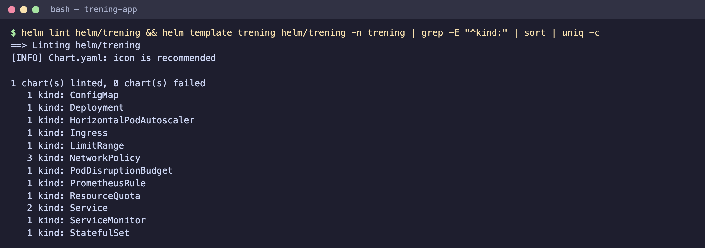

**2. Aplikacja Argo CD** (repozytorium, ścieżka, rewizja, auto-sync):

```bash
kubectl -n argocd get app trening -o wide
```
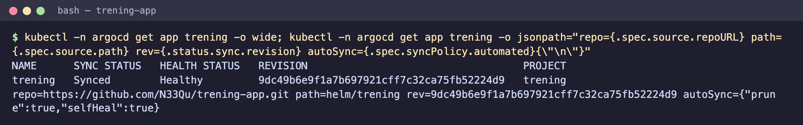

Drzewo zasobów w interfejsie Argo CD (Synced / Healthy, w tym `trening-quota` i `trening-limits`):

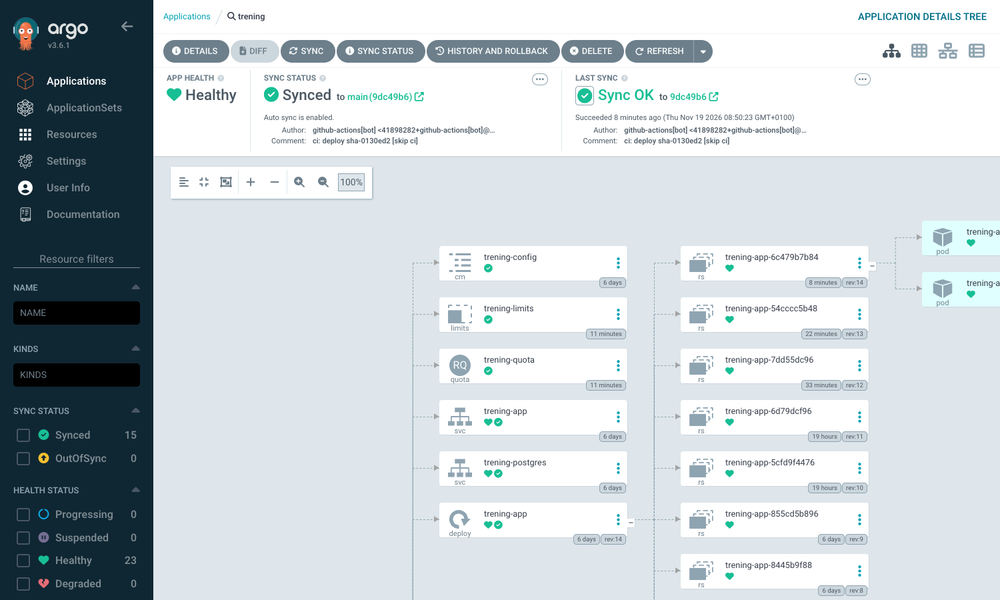

**3. Wszystkie obiekty przestrzeni nazw** (Deployment, StatefulSet, Service, PVC, Ingress, NetworkPolicy, ConfigMap, Secret, ResourceQuota, LimitRange, HPA, PDB):

```bash
kubectl get all,pvc,ingress,networkpolicy,configmap,secret,resourcequota,limitrange,hpa,pdb -n trening
```
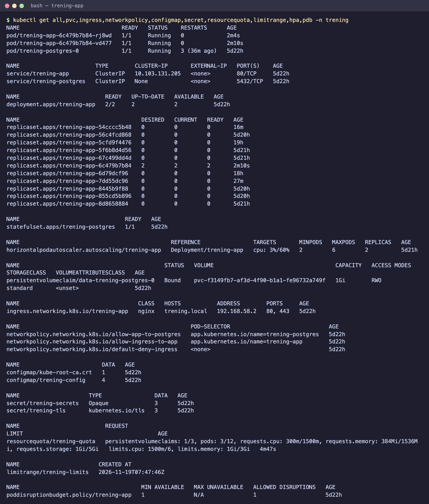

**4. ResourceQuota i LimitRange** (zużycie względem limitów):

```bash
kubectl describe resourcequota,limitrange -n trening
```
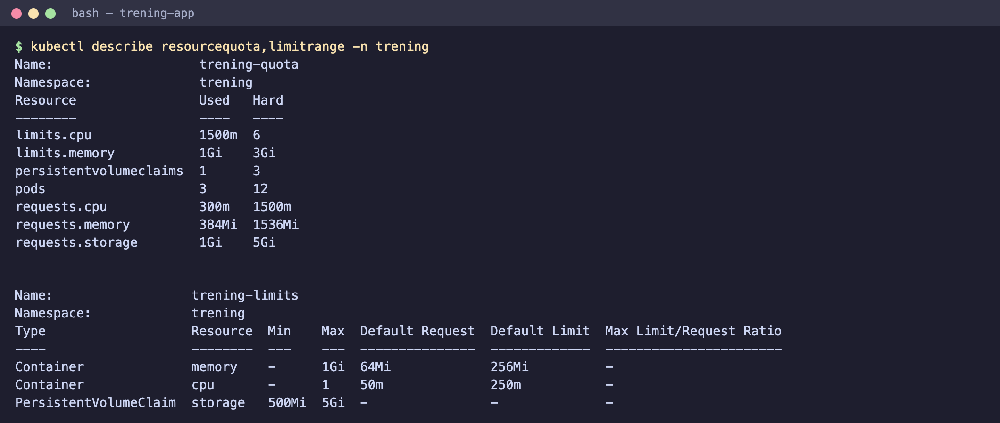

**5. Requests i limits kontenerów:**

```bash
kubectl -n trening get deploy,sts -o custom-columns=NAME:.metadata.name,CPU_REQ:...,MEM_REQ:...,CPU_LIM:...,MEM_LIM:...
```
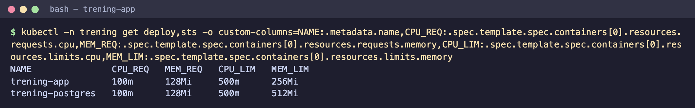

**6. Secret i ConfigMap** (`describe` pokazuje tylko nazwy kluczy i rozmiary, bez wartości):

```bash
kubectl -n trening describe secret trening-secrets; kubectl -n trening describe configmap trening-config
```
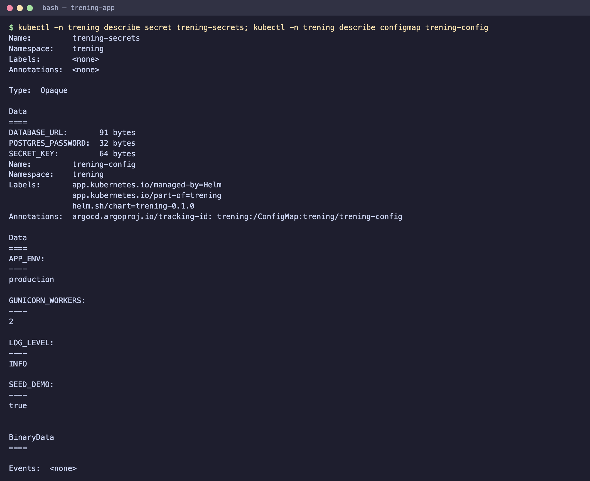

**7. NetworkPolicy:**

```bash
kubectl -n trening get networkpolicy; kubectl -n trening describe networkpolicy allow-app-to-postgres
```
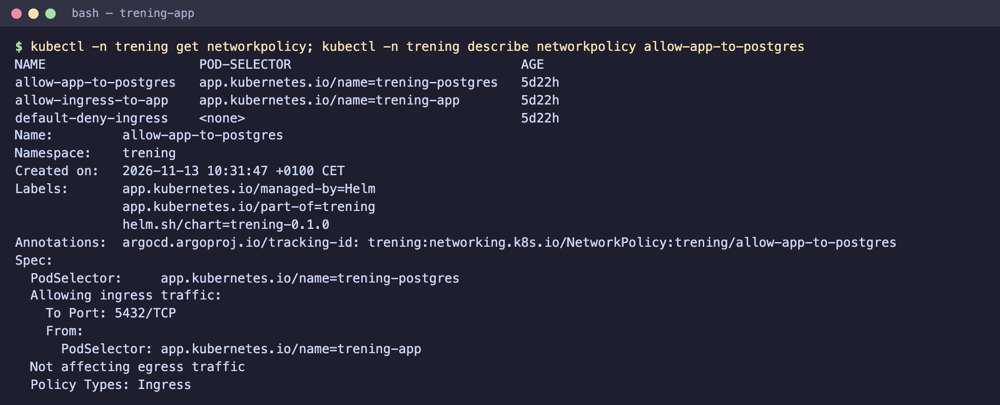

**8. Pipeline CI dla tej wersji** (GitHub Actions, run #13: test → build → deploy):

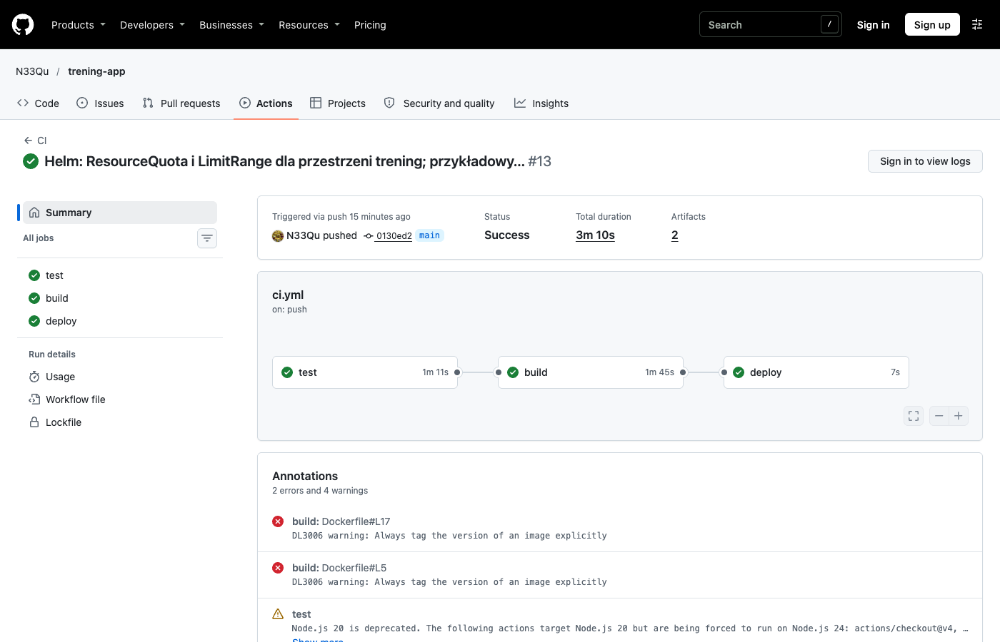

Weryfikacja serwerowa manifestów przed wdrożeniem: `helm template trening helm/trening -n trening | kubectl apply -n trening --dry-run=server -f -`
(wszystkie obiekty zaakceptowane). Po wdrożeniu przez Argo CD zużycie kwoty wynosi 3 z 12 podów, 300m z 1500m requests CPU i 384Mi z 1536Mi requests pamięci.

---

## 3. Testy 1–5

Numeracja, nazwy i kryteria zaliczenia pochodzą z opisu projektu (zadanie cząstkowe 2).
Dostęp do aplikacji z komputera: port-forward kontrolera ingress-nginx
(`kubectl -n ingress-nginx port-forward svc/ingress-nginx-controller 8443:443 8080:80`) i `curl --resolve trening.local:8443:127.0.0.1 --cacert certs/trening-ca.crt`
(CA klastra z `infra/export-ca.sh`).

### Test 1. Wdrożenie i dostęp HTTPS

**Odniesienie:** test 1 z opisu projektu (zadanie cząstkowe 2).  
**Cel:** potwierdzić, że aplikacja jest wdrożona przez Argo CD i dostępna przez HTTPS z certyfikatem własnego CA.  
**Kryterium zaliczenia:** wszystkie pody `Running/Ready`, PVC `Bound`, aplikacja w Argo CD `Synced/Healthy`; strona odpowiada przez HTTPS
z certyfikatem własnego CA, a HTTP przekierowuje na HTTPS.

**Polecenia:**

```bash
kubectl get pods,pvc -n trening; kubectl get certificate,ingress -n trening; kubectl -n argocd get app trening
curl -v --resolve trening.local:8443:127.0.0.1 --cacert certs/trening-ca.crt https://trening.local:8443/healthz
curl -sI --resolve trening.local:8080:127.0.0.1 http://trening.local:8080/
echo | openssl s_client -connect 127.0.0.1:8443 -servername trening.local -CAfile certs/trening-ca.crt   # i bez -CAfile
```

Pody, PVC, certyfikat, Ingress, Argo CD:

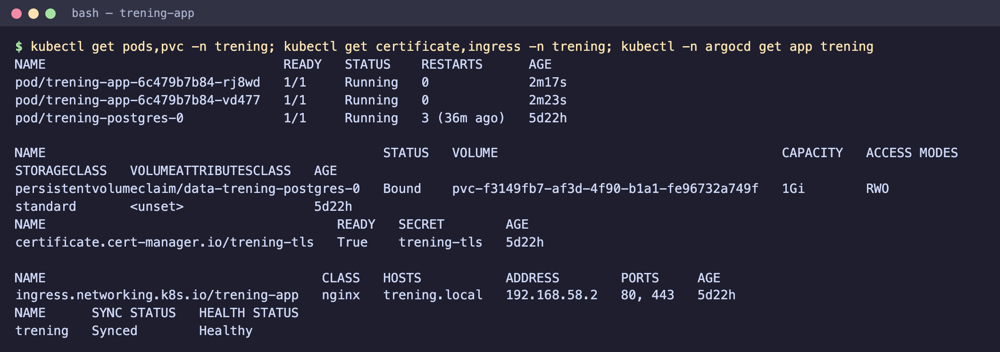

HTTPS z certyfikatem własnego CA (`issuer: CN=trening-root-ca`, `SSL certificate verify ok`, TLSv1.3, HTTP/2 200):

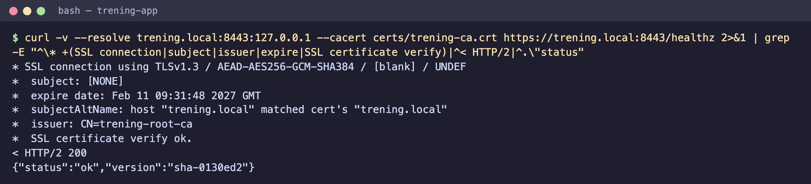

Przekierowanie HTTP → HTTPS (308) oraz weryfikacja certyfikatu z CA projektu (`Verification: OK`) i bez niego (błąd – certyfikat z prywatnego CA):

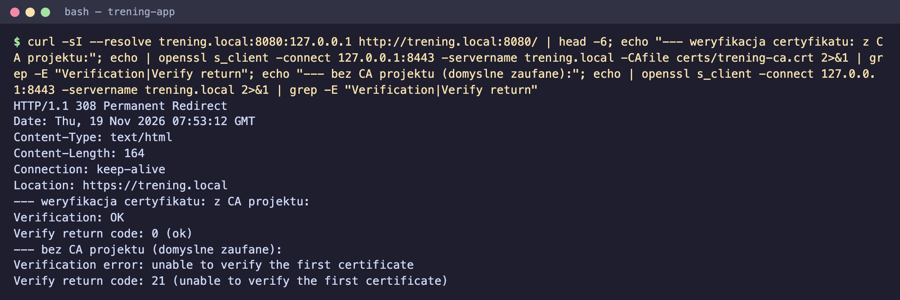

Strona aplikacji otwarta w przeglądarce pod `https://trening.local/`:

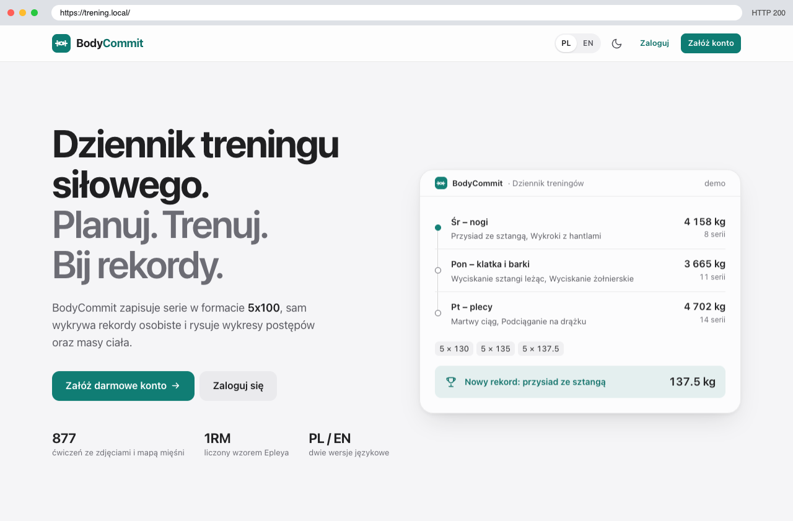

Ta sama strona w Google Chrome na komputerze z zaufanym certyfikatem własnego CA (dostęp przez port-forward kontrolera
ingress na porcie 8443). Pasek adresu nie pokazuje ostrzeżenia, a informacje o witrynie potwierdzają bezpieczne połączenie
(„Connection is secure”):

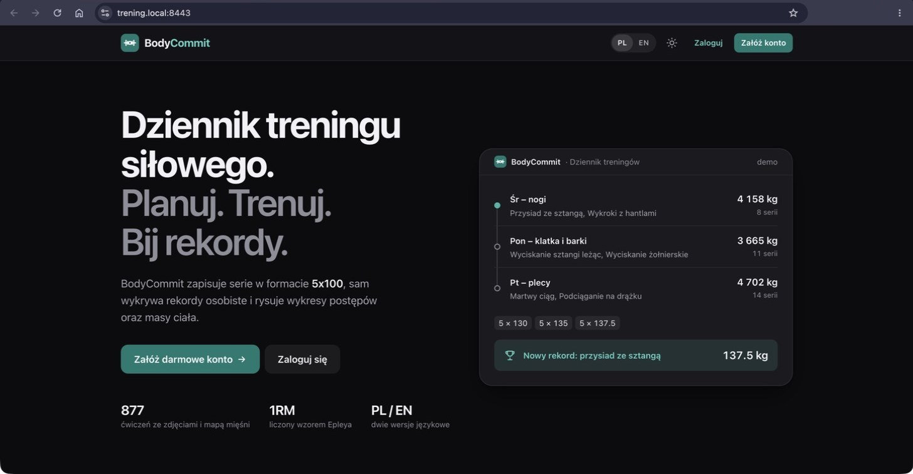

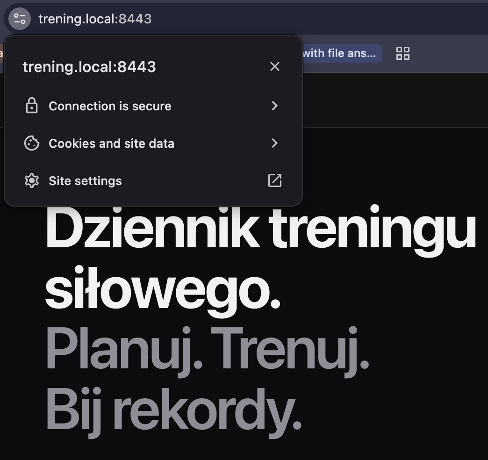

**Wynik: ZALICZONY.** Dwa pody aplikacji i `trening-postgres-0` w stanie `Running 1/1`, PVC `data-trening-postgres-0` `Bound` (1 Gi),
Argo CD `Synced / Healthy`, certyfikat `Ready`, HTTPS z weryfikacją własnego CA, HTTP zwraca `308 Permanent Redirect` na HTTPS
(przy port-forwardzie nagłówek `Location` nie zawiera numeru portu 8443).

### Test 2. Funkcje aplikacji i izolacja użytkowników

**Odniesienie:** test 2 z opisu projektu (zadanie cząstkowe 2).  
**Cel:** sprawdzić podstawowe funkcje przez Ingress z HTTPS oraz izolację danych użytkowników; hasła w bazie jako skróty.  
**Kryterium zaliczenia:** dane A zapisane i widoczne, rekord wykryty automatycznie; B dostaje odmowę dostępu (403/404) do danych A; hasło w bazie zapisane jako hash.

**Polecenia:**

```bash
python infra/e2e_check.py setup --ca certs/trening-ca.crt     # użytkownicy A i B, plan, trening z rekordem, masa ciała, próby dostępu B
kubectl -n trening exec trening-postgres-0 -- psql -U trening -d trening -c "select username, left(password_hash,25), length(password_hash) from users ..."
```

Scenariusz automatyczny (rejestracja A i B, A tworzy plan, zapisuje trening z komunikatem „Nowy rekord!” i pomiar masy 82,5 kg;
B próbuje otworzyć trening A, jego edycję i plan A; żądanie bez logowania; POST bez CSRF) – 14 sprawdzeń `OK`:

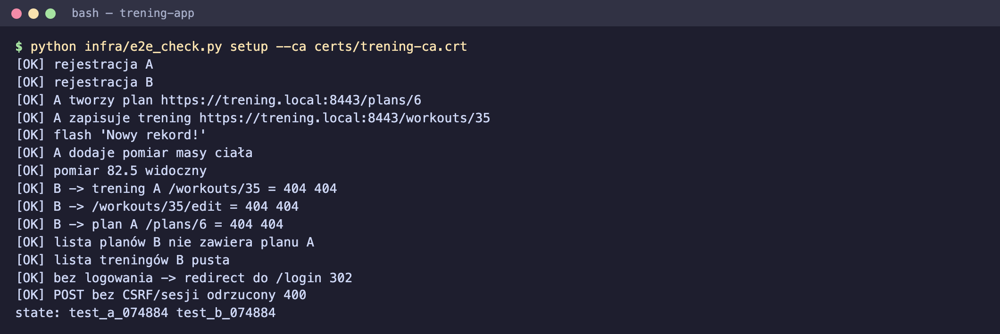

Hasła w bazie to skróty scrypt (162 znaki), nie jawne hasła:

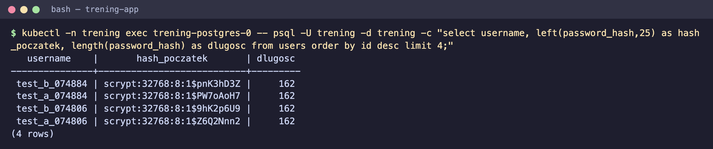

Te same operacje w przeglądarce (aplikacja przez `kubectl port-forward svc/trening-app 8000:80`, użytkownik A):

| | |
|---|---|
| 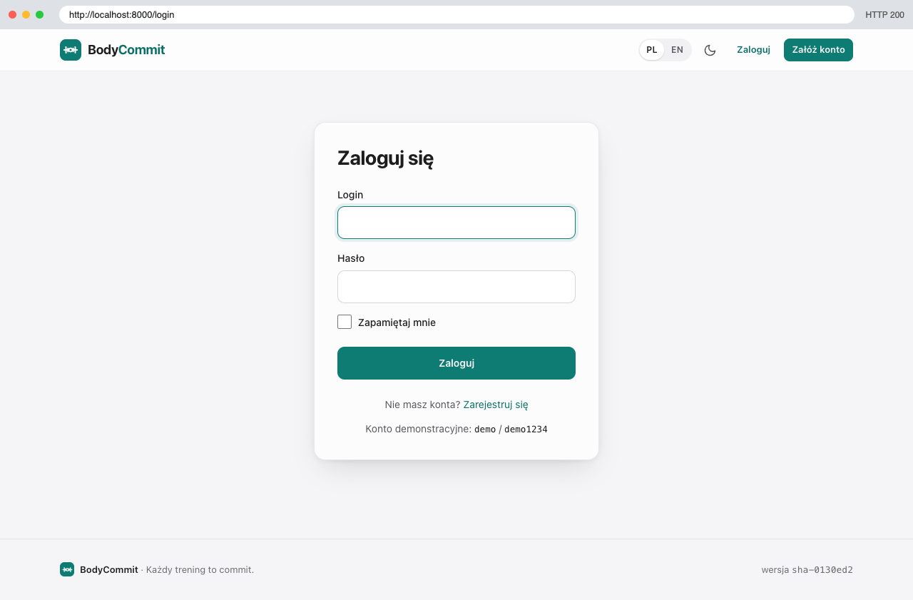 | 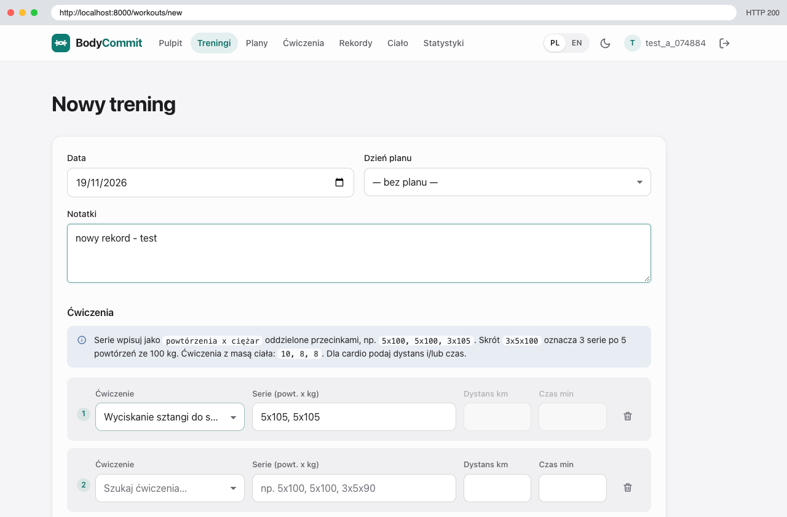 |
| Logowanie | Nowy trening: serie `5x105, 5x105` |

Zapis treningu – komunikat „Nowy rekord!” (maksymalny ciężar 105 kg i szacowane 1RM 122,5 kg), rekordy z treningu:

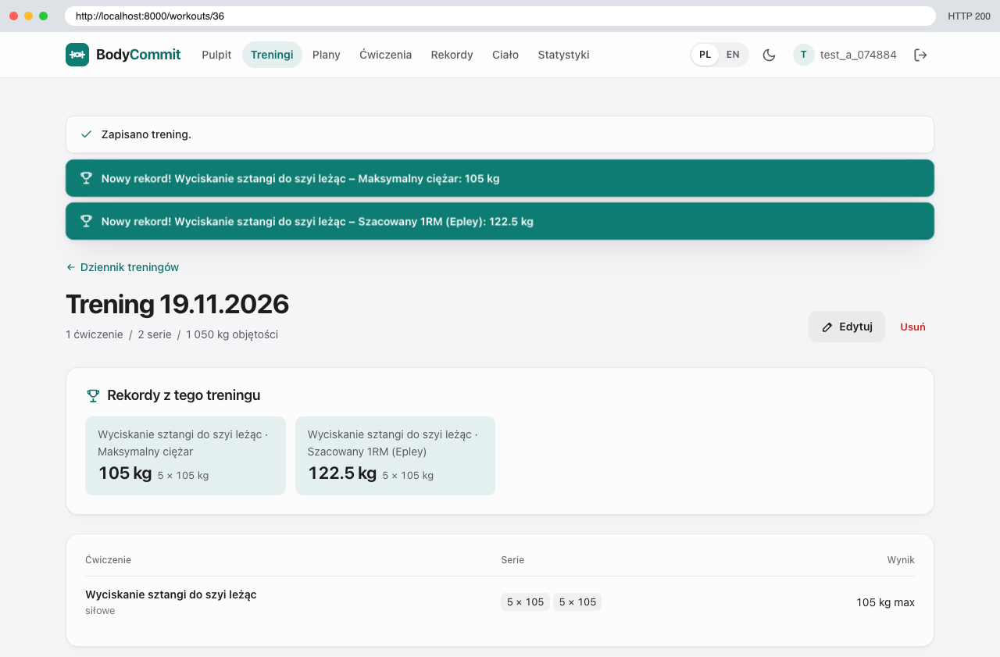

Plan A, pomiar masy ciała oraz wykresy (konto demonstracyjne z danymi z 12 tygodni):

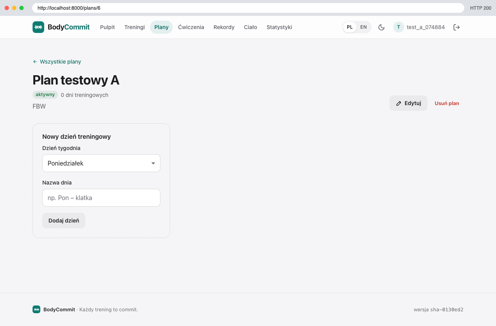
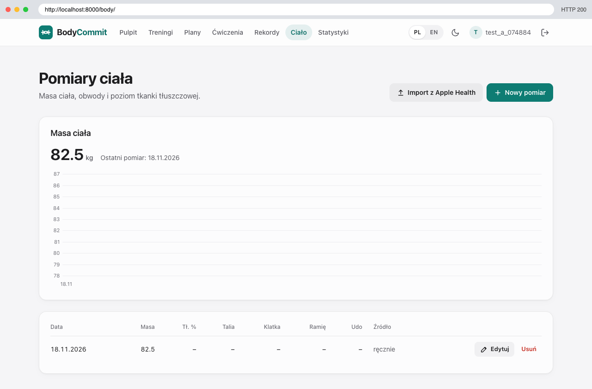
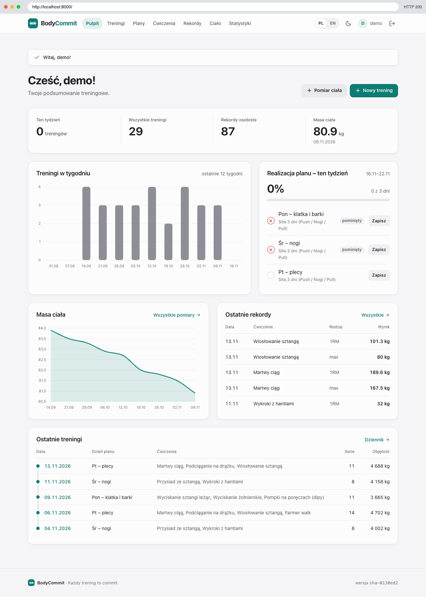

Użytkownik B (osobne konto) otwiera adres treningu i planu użytkownika A – **HTTP 404** (kod widoczny w pasku zrzutu):

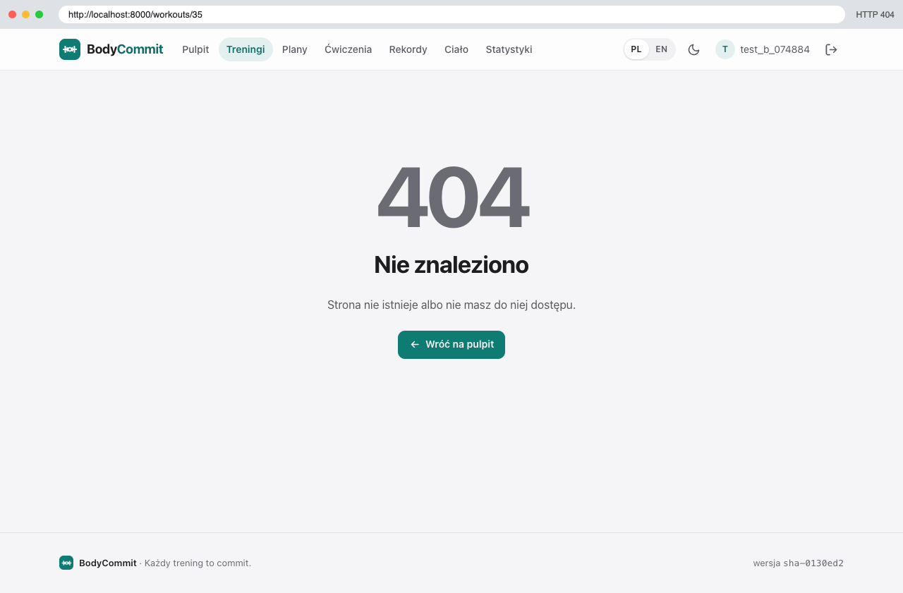
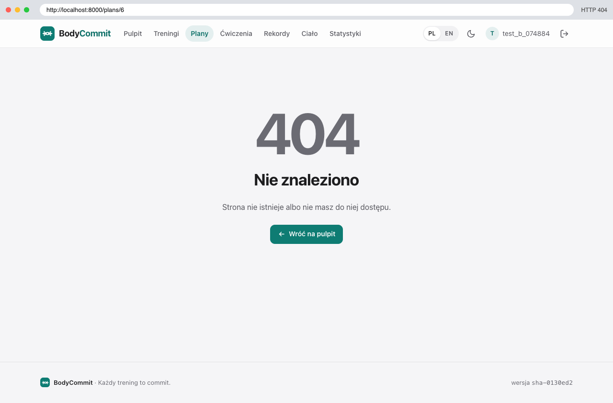

**Wynik: ZALICZONY.** 14/14 sprawdzeń; B otrzymuje 404 dla treningu A (`/workouts/<id>`, `/edit`) i planu A (`/plans/<id>`), listy B nie zawierają danych A;
bez logowania następuje przekierowanie na `/login`, POST bez tokenu CSRF jest odrzucany (400); hasła zapisane jako `scrypt:32768:8:1$…`.
Aplikacja zwraca 404 zamiast 403, aby nie ujawniać istnienia cudzych zasobów.

### Test 3. Trwałość danych i konfiguracji

**Odniesienie:** test 3 z opisu projektu (zadanie cząstkowe 2).  
**Cel:** dane przetrwają usunięcie podów bazy i aplikacji; sekrety nie występują w repozytorium ani w obrazie.  
**Kryterium zaliczenia:** po odtworzeniu podów wszystkie dane A są obecne; hasła występują tylko w Secret, nie w repozytorium ani w obrazie.

**Polecenia:**

```bash
kubectl -n trening delete pod/trening-postgres-0 pod/<pod trening-app>
kubectl -n trening wait --for=condition=Ready pod/trening-postgres-0 --timeout=180s
python infra/e2e_check.py verify --ca certs/trening-ca.crt                # A loguje się ponownie, sprawdza dane
git grep -n "kind: Secret" -- . ":!docs"; git grep -niE "(password|secret_key|token|api_key)\s*[:=]\s*[\"'][^\"']{6,}" -- . ':!tests' ':!docs'
kubectl -n trening get secret trening-secrets -o json | ...               # tylko nazwy kluczy i długości
minikube -p bpcicd ssh -- docker image inspect ghcr.io/n33qu/trening-app:sha-0130ed2 | ...   # tylko nazwy zmiennych
```

Usunięcie podów (po ok. 10 s oba wracają do `Ready`, PVC pozostaje `Bound` z tym samym wolumenem `pvc-f3149fb7…`):

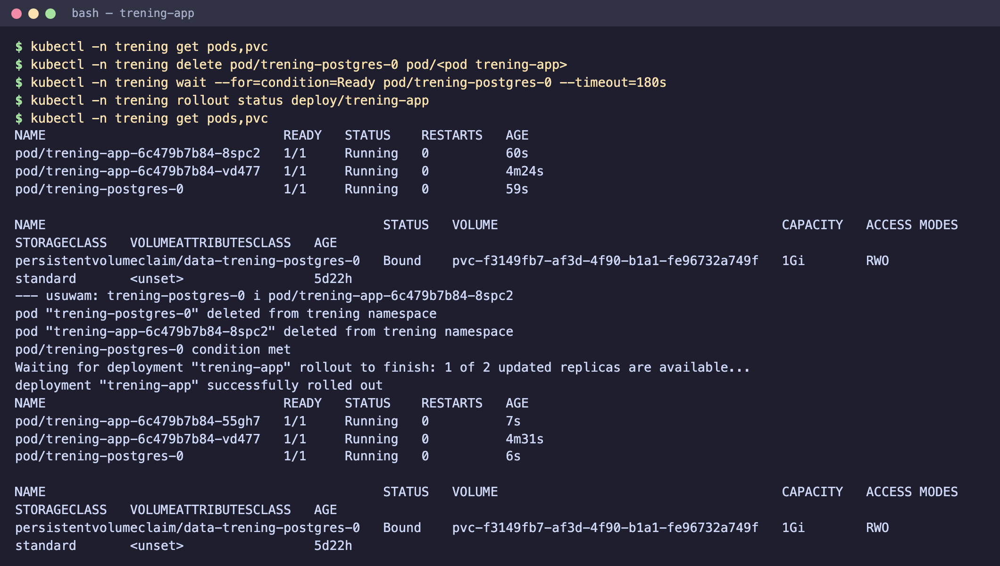

Ponowne logowanie użytkownika A i sprawdzenie danych (5/5 `OK`: konto, trening, rekord, plan, masa 82,5 kg):

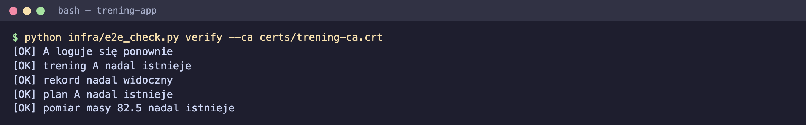

Sekrety poza repozytorium i obrazem:

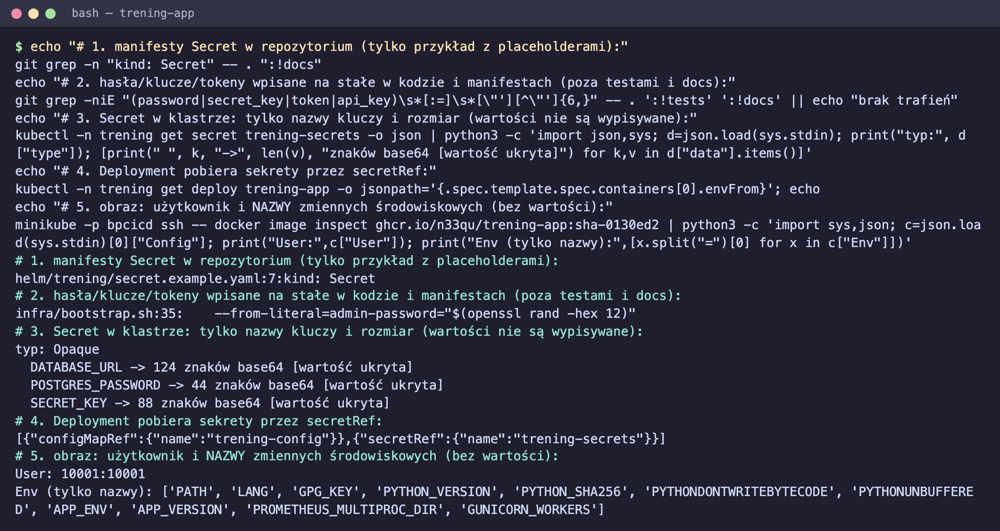

**Wynik: ZALICZONY.** Dane A (trening, rekord, plan, pomiar) są obecne po usunięciu obu podów. W repozytorium jedynym obiektem `kind: Secret`
jest przykład z placeholderami (`helm/trening/secret.example.yaml`, poza `templates/`, nie wdrażany); jedyne trafienie wyszukiwania haseł to
generowanie losowego hasła Grafany w `infra/bootstrap.sh`. Obiekt `trening-secrets` w klastrze ma 3 klucze (wartości nie są pokazywane),
Deployment pobiera go przez `secretRef`. Obraz działa jako `10001:10001`, a jego zmienne środowiskowe nie zawierają haseł
(`GPG_KEY` to publiczny identyfikator klucza obrazu bazowego Pythona, nie sekret).

### Test 4. Autoskalowanie HPA

**Odniesienie:** test 4 z opisu projektu (zadanie cząstkowe 2).  
**Cel:** pod obciążeniem HPA zwiększa liczbę replik aplikacji, po jego ustaniu wraca do minimum; dodatkowo sprawdzamy, że ResourceQuota
mieści 6 replik wraz z bazą.  
**Kryterium zaliczenia:** liczba replik rośnie od minimum do co najmniej 2× pod obciążeniem i wraca do minimum po jego zakończeniu; aplikacja odpowiada przez cały test.

**Polecenia:**

```bash
k6 run -e HOSTS_IP=127.0.0.1:8443 -e VUS=50 infra/loadtest/k6.js        # 50 VU, 4,5 min: GET / oraz GET /healthz
# równolegle, co 15 s: kubectl -n trening get hpa trening-app; kubectl -n trening get pods
kubectl -n trening describe resourcequota trening-quota; kubectl -n trening top pods     # w szczycie obciążenia
```

HPA: minimum 2, maksimum 6, cel 60% CPU względem requests (100m).

Wynik k6 (progi: p95 < 1 s i błędy < 1% – spełnione; 94 372 żądania, 0% błędów, p95 = 85 ms; linie postępu pominięto):

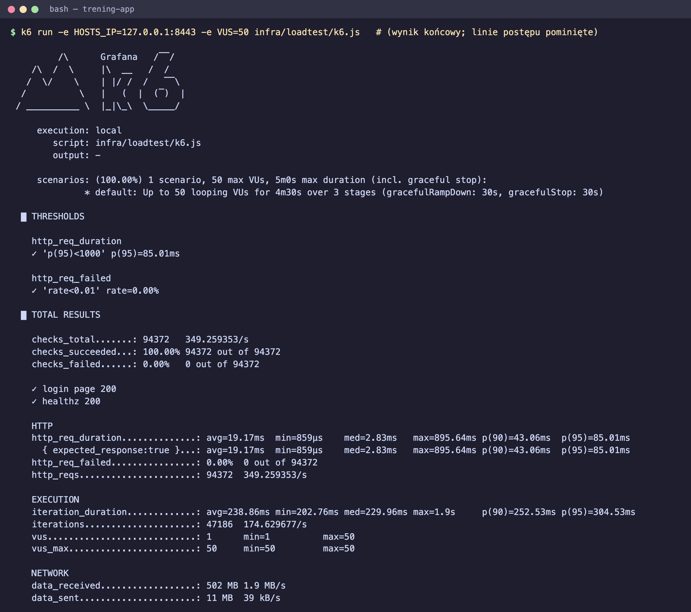

Obserwacja HPA (jedna linia na próbkę; start k6 o 08:57:00):

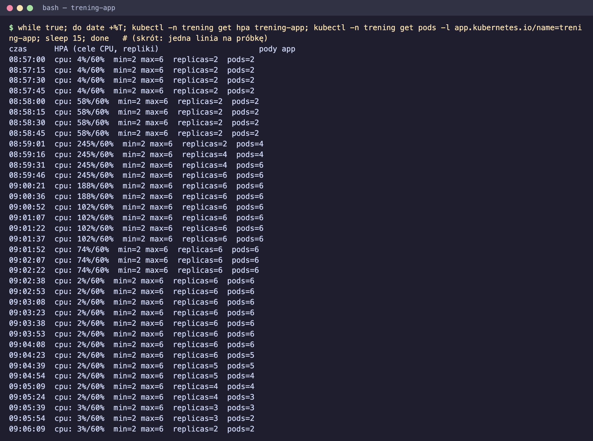

| Czas | Zdarzenie |
|------|-----------|
| 08:57:00 | start k6, 2 repliki |
| 08:59:01 – 08:59:46 | CPU 245% celu; HPA 2 → 4 → 6 (maksimum) |
| ok. 09:02:30 | koniec obciążenia (CPU spada z 74% do 2%) |
| 09:04:23 – 09:06:09 | 6 → 5 → 4 → 3 → 2 (okno stabilizacji 120 s, potem 1 pod / 30 s) |

Zdarzenia HPA (`SuccessfulRescale`):

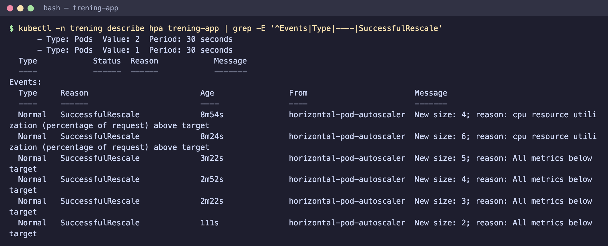

ResourceQuota w szczycie obciążenia (6 replik aplikacji + baza = 7 podów; zużycie nadal poniżej limitów, rollout i skalowanie nie zostały odrzucone):

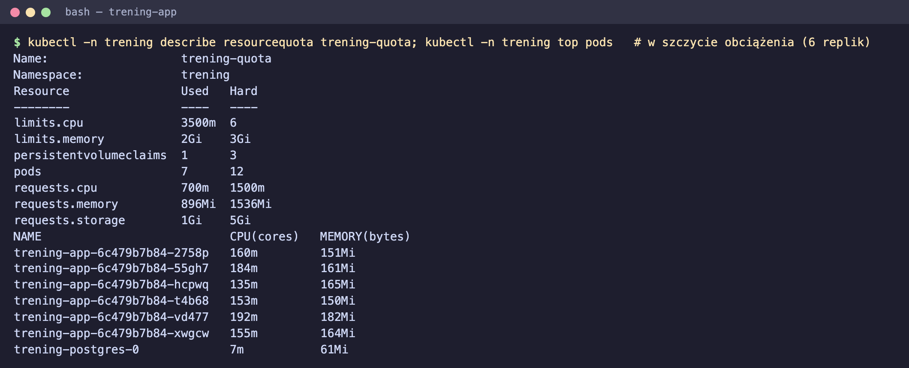

Interfejs Argo CD w szczycie obciążenia (6 podów `trening-app`, aplikacja `Synced / Healthy`):

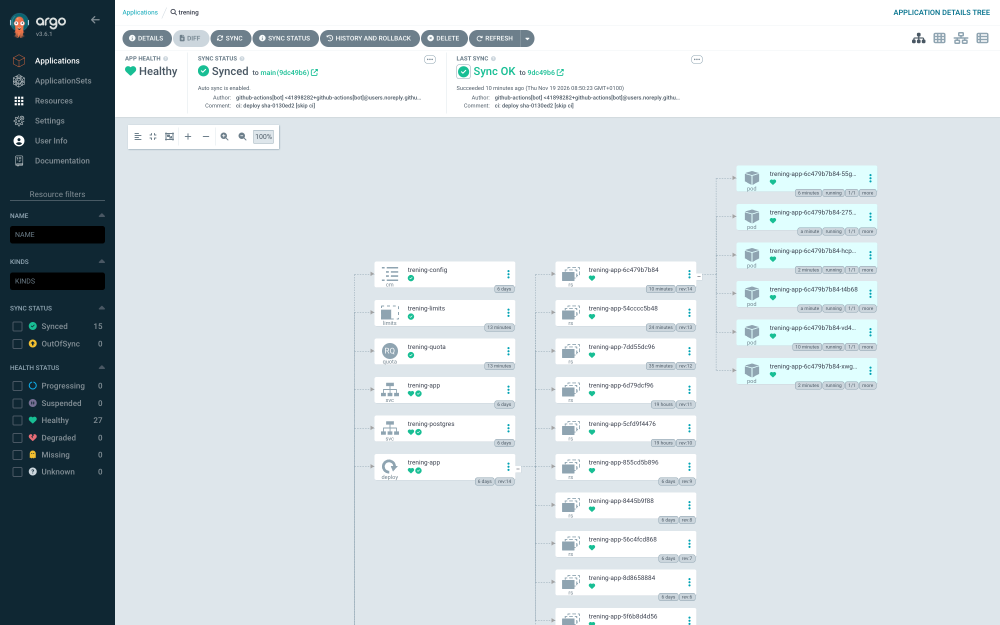

Dashboard Grafany „Trening App” – cały test (ruch do ok. 450 req/s, p95 poniżej 0,1 s, repliki 2 → 6 → 2, CPU i pamięć podów):

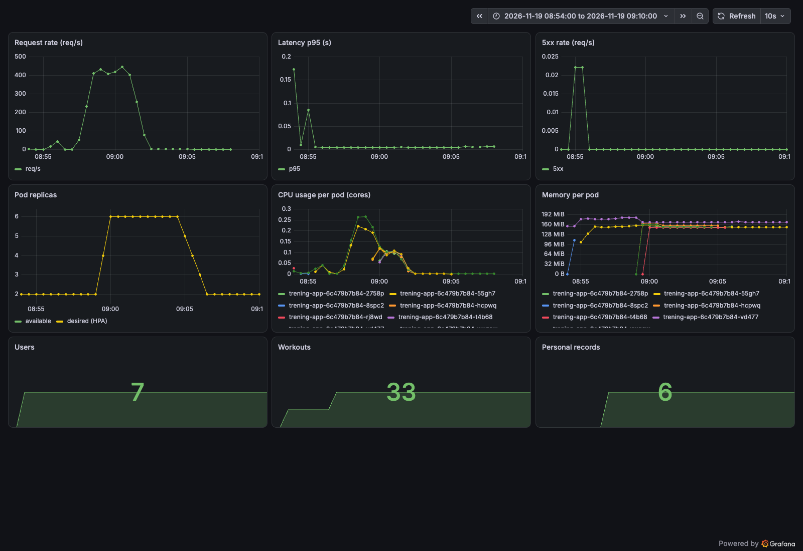

Dashboard w szczycie obciążenia (okno „ostatnie 12 minut”):

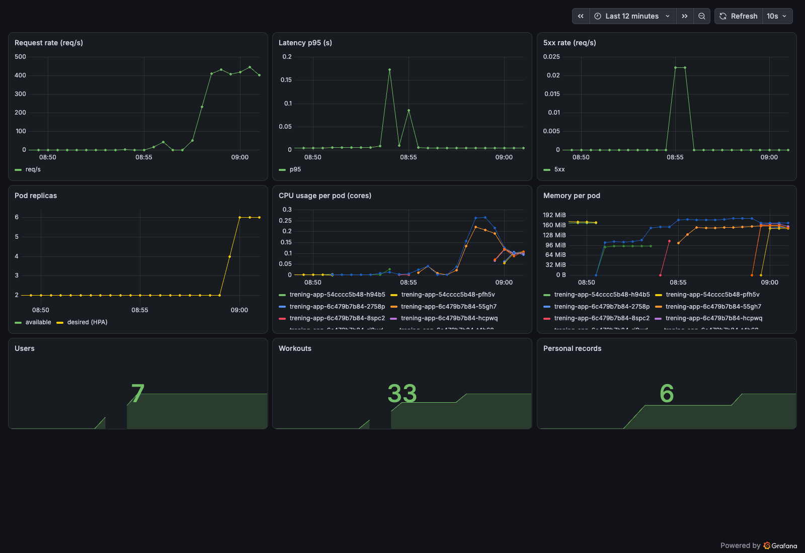

**Wynik: ZALICZONY.** Repliki: 2 → 6 (3× minimum, wymagane ≥ 2×) → 2; aplikacja odpowiadała przez cały test (0% błędów, p95 = 85 ms).
Kwota przestrzeni nazw w szczycie: 7/12 podów, requests 700m/1500m CPU i 896Mi/1536Mi pamięci, limits 3500m/6 CPU i 2Gi/3Gi.
Krótki skok 5xx widoczny na wykresie Grafany około 08:55 wystąpił przed właściwym przebiegiem (po poprzednich działaniach na podach);
w oknie obciążenia 5xx = 0.

### Test 5. Pipeline CI/CD, GitOps i monitoring

**Odniesienie:** test 5 z opisu projektu (zadanie cząstkowe 2).  
**Cel:** pokazać pełną ścieżkę zmiany (push → testy → Trivy → obraz → Argo CD), rollback z gita oraz alert przy niedostępności aplikacji.  
**Kryterium zaliczenia:** pipeline przechodzi testy i skan Trivy bez podatności CRITICAL; nowa wersja widoczna w aplikacji bez ręcznego `kubectl apply`;
rollback przywraca poprzednią wersję; przy 0 replikach pojawia się alert.

#### 5a. Zmiana, CI i wdrożenie przez Argo CD

Zmiana: dopisek „wdrożono przez GitOps” w stopce aplikacji (`app/templates/base.html`), commit i push:

```bash
git add app/templates/base.html && git commit -m "Stopka: znacznik wdrożenia przez GitOps (demonstracja testu 5)" && git push
```
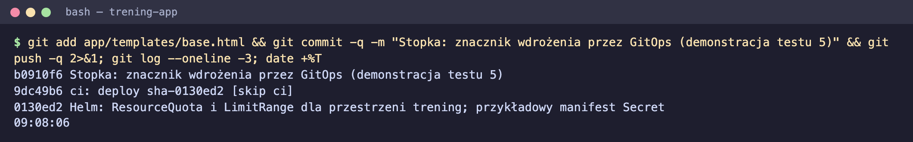

Pipeline GitHub Actions (run [44485055521](https://github.com/N33Qu/trening-app/actions/runs/44485055521), 3 min 35 s, wszystkie zadania `success`):

```bash
gh run view 44485055521 --verbose
```
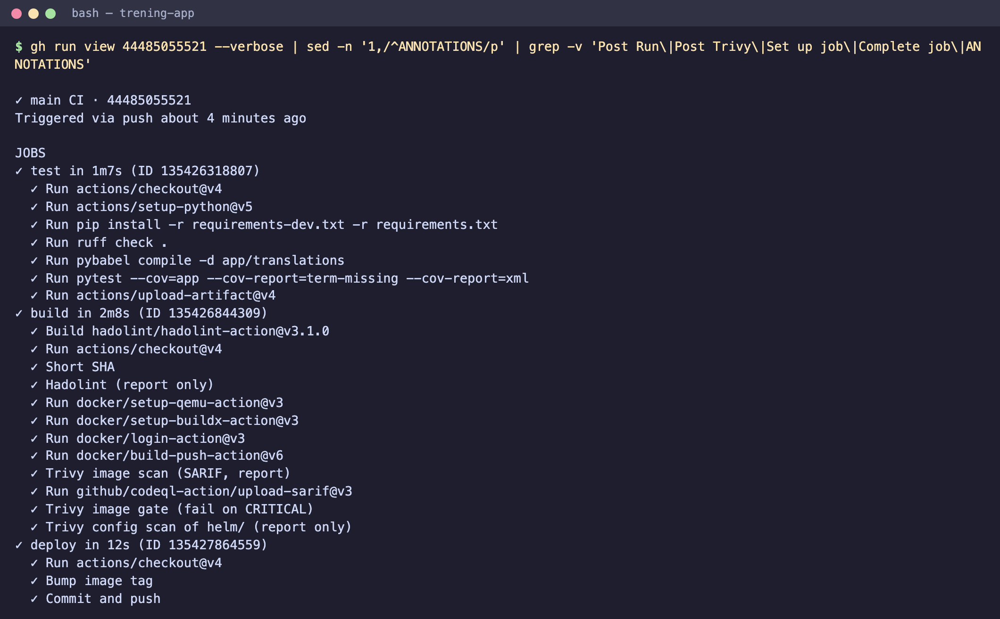


Zadanie `test` obejmuje ruff i pytest; `build` – budowę obrazu, Hadolint, skan Trivy obrazu (krok **Trivy image gate (fail on CRITICAL)**
zakończony sukcesem, czyli brak podatności CRITICAL) i skan konfiguracji; `deploy` – commit z nowym tagiem. Commit CI zmienił tag
`sha-0130ed2` → `sha-b0910f6` w `helm/trening/values.yaml`:

```bash
git pull --rebase --autostash && git log --oneline -3 && git show HEAD -- helm/trening/values.yaml
```
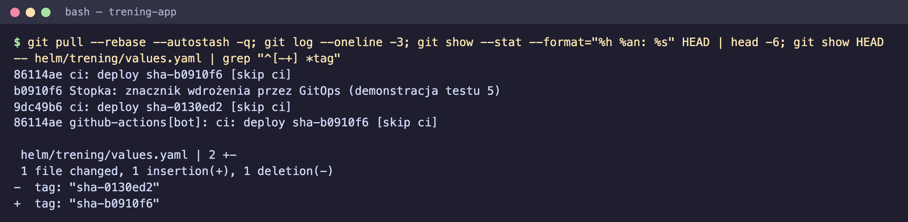

Argo CD pobrał commit i wdrożył nowy obraz bez `kubectl apply`; `/healthz` zwraca nową wersję:

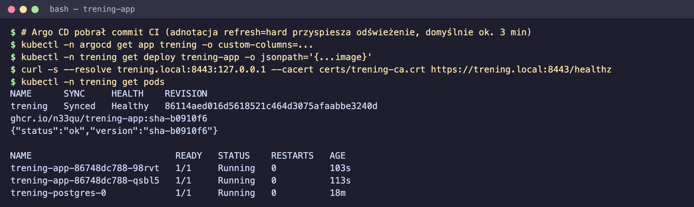
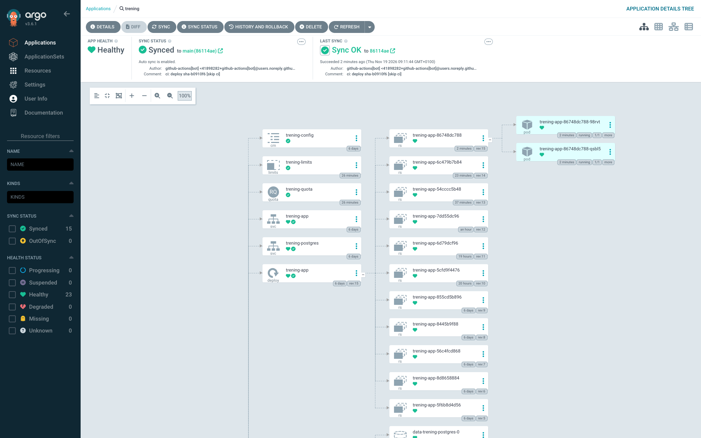

Nowa wersja widoczna w aplikacji (stopka: „wdrożono przez GitOps”, `wersja sha-b0910f6`), strona przez HTTPS:

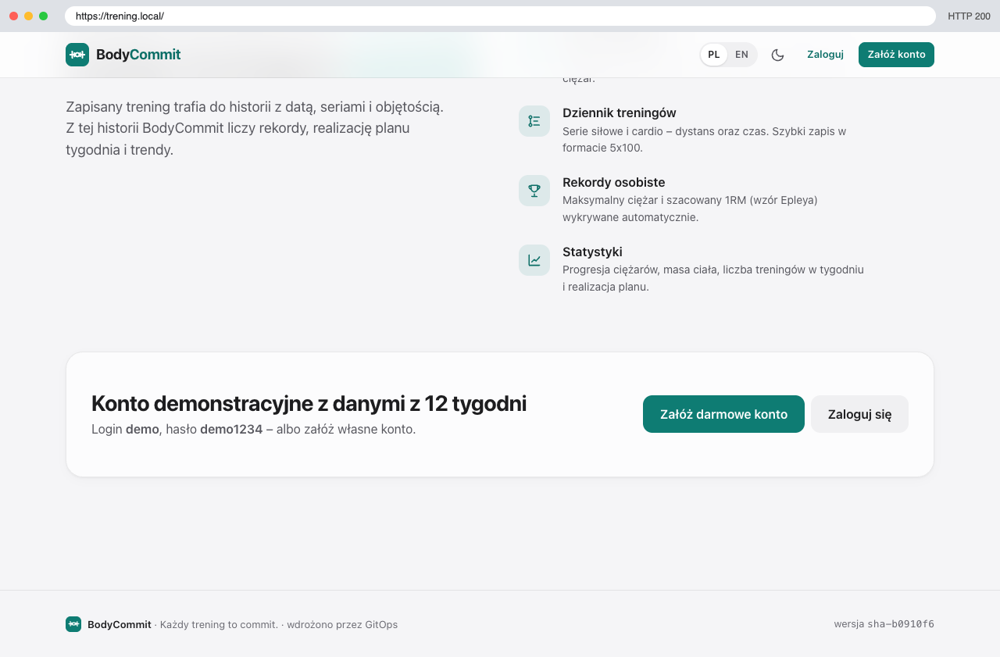

Po wymianie podów Argo CD przez krótki czas pokazuje `Degraded` (HPA nie ma jeszcze metryk dla nowych podów); stan ustępuje samoczynnie
(zrzut powyżej pokazuje `Healthy`).

#### 5b. Rollback przez `git revert`

Wycofano jednym commitem zmianę w stopce i commit CI z tagiem (`git revert --no-commit` obu commitów); commit z `[skip ci]`, bo kod i tag
wracają dokładnie do wcześniej przetestowanego stanu (obraz `sha-0130ed2` już istnieje w GHCR):

```bash
git revert --no-commit 86114ae b0910f6
git commit -m "Wycofanie zmiany w stopce i tagu wdrożenia (rollback przez git revert) [skip ci]" && git push
```
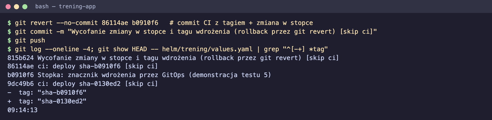

Argo CD przywrócił poprzednią wersję (`sha-0130ed2`, `/healthz` → `sha-0130ed2`, stopka bez dopisku):

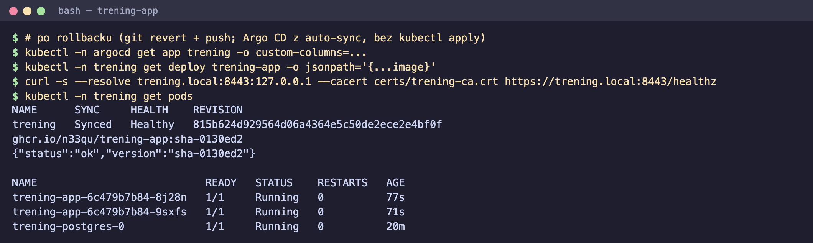


#### 5c. Monitoring i alert

Stan wyjściowy – reguły alertów, 2 targety `up = 1`, brak aktywnych alertów:

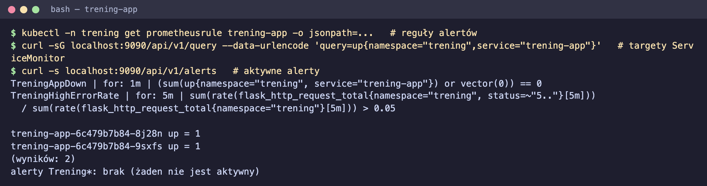

Wywołanie awarii: wyłączono auto-sync Argo CD (inaczej `selfHeal` przywróciłby repliki), usunięto HPA i skalowano Deployment do 0:

```bash
kubectl -n argocd patch application trening --type merge -p '{"spec":{"syncPolicy":{"automated":null}}}'
kubectl -n trening delete hpa trening-app
kubectl -n trening scale deploy trening-app --replicas=0
```
`TreningAppDown`: `pending` od 09:16:45, `firing` od 09:17:45 (reguła `for: 1m`):

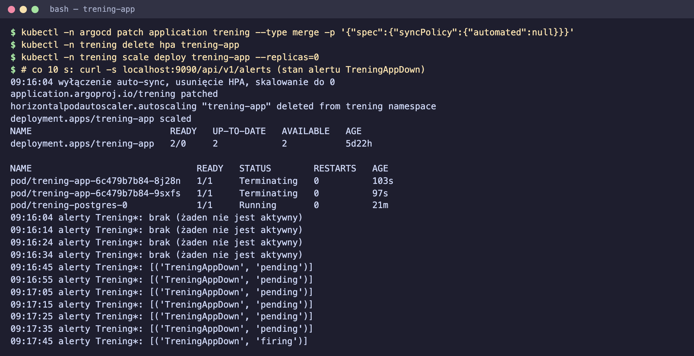

Alert `TreningAppDown` w Prometheusie (stan **FIRING**, `severity="critical"`):

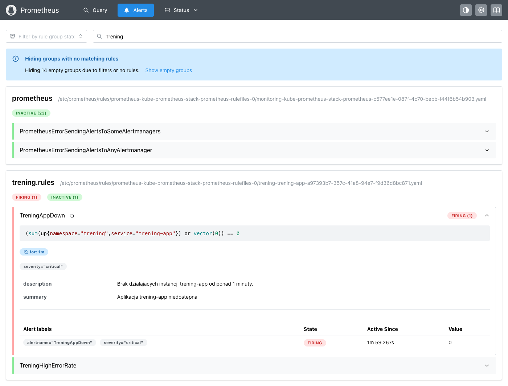

Przywrócenie: `kubectl apply -f argocd/application.yaml` (ponownie auto-sync z `prune` i `selfHeal`, Argo CD odtworzył HPA) i
`kubectl -n trening scale deploy trening-app --replicas=2`. Alert zniknął o 09:19:09, aplikacja `Synced / Healthy`, 2 repliki, HPA aktywny:

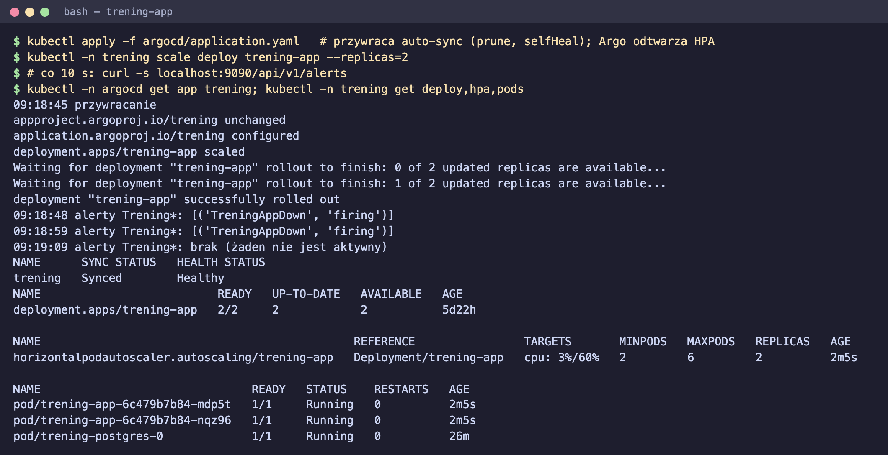

**Wynik: ZALICZONY.** Pipeline `test → build (Trivy, bez CRITICAL) → deploy` zakończony sukcesem; nowa wersja trafiła do klastra przez Argo CD
(rewizja = commit CI, bez ręcznego `kubectl apply`); rollback przez `git revert` przywrócił poprzedni obraz; przy 0 replikach alert
`TreningAppDown` przeszedł w stan firing. Alert jest widoczny w Prometheusie (reguła z `PrometheusRule`); nie wykonywano osobnego zrzutu
widoku alertów w interfejsie Grafany.

---

## 4. Komentarz do funkcjonalności

### Plan (opis projektu) a realizacja

| Zaplanowane | Zrealizowane | Uwagi |
|-------------|--------------|-------|
| Konta i logowanie, hasła jako hash, sesja | tak | rejestracja, logowanie, wylogowanie; hasła scrypt; ochrona CSRF; test 2 |
| Plany treningowe (tydzień, ćwiczenia z katalogu lub własne) | tak | CRUD planów z dniami i ćwiczeniami; własne ćwiczenia użytkownika |
| Dziennik treningów (serie, powtórzenia, ciężar / dystans i czas, powiązanie z planem) | tak | zapis serii w formacie `powt. x kg` (np. `5x100`), cardio: dystans i czas |
| Rekordy (PR) wykrywane automatycznie | tak | maksymalny ciężar i szacowane 1RM (wzór Epleya), komunikat „Nowy rekord!” |
| Pomiary ciała (ręcznie; import z Apple Health jako rozszerzenie) | częściowo | masa ciała, tkanka tłuszczowa, obwody – ręcznie i import pliku; import z Apple Health nie został zrealizowany jako integracja |
| Statystyki i wykresy (postęp, historia rekordów i masy, treningi w tygodniu, realizacja planu) | tak | pulpit i strona statystyk z wykresami |
| HTTPS pod własną domeną klastra (Ingress + cert-manager, własne CA) | tak | `trening.local`, CA `trening-root-ca`, HTTP → HTTPS (test 1) |
| Trwałość danych (StatefulSet + PVC) | tak | test 3 |
| Konfiguracja w ConfigMap, sekrety w Secret poza obrazem i repozytorium | tak | `infra/create-secrets.sh`, test 3 |
| Autoskalowanie HPA | tak | 2–6 replik, test 4 |
| Monitoring: Prometheus, Grafana, ServiceMonitor, alert niedostępności | tak | dashboard „Trening App”, alerty `TreningAppDown`, `TreningHighErrorRate` (test 5c) |
| CI/CD i GitOps: testy, build, Trivy, Argo CD, rollback | tak | test 5; bramka Trivy na CRITICAL |

### Dodatki ponad plan

- biblioteka 877 ćwiczeń ze zdjęciami, opisami techniki i mapą mięśni (wyszukiwarka, filtry), polskie i angielskie nazwy;
- wersja językowa PL/EN, jasny i ciemny motyw, układ responsywny od 375 px, nowa identyfikacja wizualna „BodyCommit”;
- ResourceQuota i LimitRange dla przestrzeni nazw, PodDisruptionBudget, NetworkPolicy typu default-deny;
- utwardzenie kontenerów (nie-root, `readOnlyRootFilesystem`, `drop ALL`, seccomp, brak tokenu konta usługi);
- dashboard Grafany jako kod, skrypt testu funkcjonalnego (`infra/e2e_check.py`) i skrypt instalacji dodatków (`infra/bootstrap.sh`);
- skan Trivy konfiguracji Helm i raport Hadolint w pipeline.

### Znane ograniczenia

- brak integracji z Apple Health (tylko ręczny wpis i import pliku);
- jedna replika bazy PostgreSQL (brak replikacji / kopii zapasowych), PVC na StorageClass `standard` minikube;
- certyfikat z własnego CA – przeglądarka wymaga zaimportowania `certs/trening-ca.crt`, a host `trening.local` dostępu przez `/etc/hosts` lub `minikube tunnel`;
- skan konfiguracji Trivy zgłasza 1 uwagę HIGH (PostgreSQL bez `readOnlyRootFilesystem` – baza zapisuje do wolumenu), w pipeline tylko jako raport;
- przy ręcznym skalowaniu Deploymentu do 0 (test 5c) Argo CD nie przywraca replik, bo chart przy włączonym HPA nie ustawia `spec.replicas`; w normalnej pracy HPA utrzymuje minimum 2;
- aplikacja zwraca 404 (a nie 403) dla cudzych zasobów – świadoma decyzja, by nie ujawniać ich istnienia.

---

## 5. Uwagi i środowisko

| Element | Wersja |
|---------|--------|
| minikube | v1.38.1 (profil `bpcicd`, sterownik docker, CNI Calico) |
| Kubernetes (serwer) / kubectl | v1.35.1 / v1.35.2 |
| Helm / k6 / Trivy (lokalnie) | v4.3.0 / v2.4.0 / 0.76.2 |
| Docker | 29.8.2 |
| ingress-nginx / cert-manager / Argo CD | v1.14.3 / v1.21.3 / v3.6.1 |
| kube-prometheus-stack | chart 93.2.2 (Prometheus Operator v0.95.2) |
| Obraz aplikacji | `ghcr.io/n33qu/trening-app:sha-<commit>`; w testach 1–4 i 5c `sha-0130ed2`, w teście 5 przejściowo `sha-b0910f6` |
| Baza danych | `postgres:16-alpine` (StatefulSet, PVC 1 Gi) |
| Trivy w pipeline | v0.70.0 (`aquasecurity/trivy-action@v0.36.0`) |

- Testy wykonano 19.11.2026 na tej samej instalacji klastra; stan końcowy: aplikacja Argo CD `Synced / Healthy`, obraz z tagu w `helm/trening/values.yaml`
  (ustawianego przez pipeline), 2 repliki.
- Test 4 uruchomiono dwukrotnie: pierwsze uruchomienie przerwano po ok. 1 minucie (poprawa formatu zapisu obserwacji HPA), w sprawozdaniu jest
  wynik pełnego, drugiego przebiegu.
- Konta testowe `test_a_*` i `test_b_*` usunięto z bazy po zakończeniu testów (pozostało konto `demo`).
- Zrzuty terminala powstały przez wyrenderowanie rzeczywistych, niezmienionych wyników poleceń; wartości sekretów nie były nigdzie wypisywane.
- Przy ręcznym wyłączeniu auto-sync w teście 5c stan Argo CD został przywrócony poleceniem `kubectl apply -f argocd/application.yaml` (manifest z repozytorium).
- Aktualizacja chartu o ResourceQuota i LimitRange (commit `0130ed2`) została wdrożona przez Argo CD przed wykonaniem testów; zmiany dokumentacji po testach
  (to sprawozdanie) powodują kolejny przebieg pipeline’u i nowy tag obrazu bez zmian w aplikacji.
