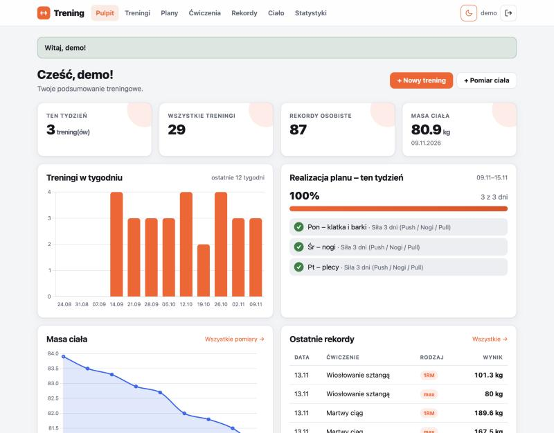
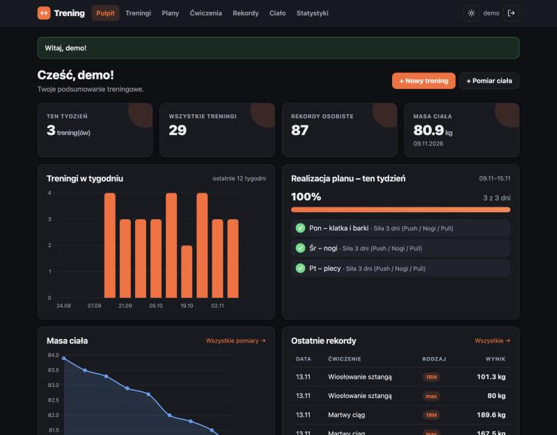
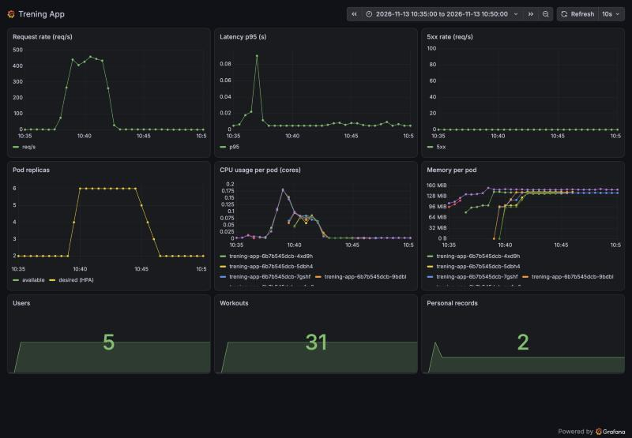
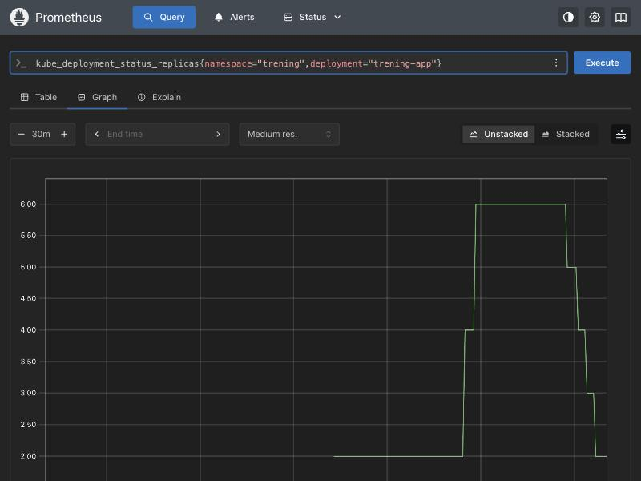

# Sprawozdanie z realizacji testów

System: **Trening** (Flask + PostgreSQL) wdrożony na Kubernetes metodą GitOps.
Data wykonania: 2026-11-13. Autorzy: Mikołaj Stasz, Ewelina Sałata.

## Podsumowanie

| # | Test | Wynik |
|---|------|-------|
| 1 | Wdrożenie i dostęp HTTPS | ZALICZONY |
| 2 | Funkcje aplikacji i izolacja użytkowników | ZALICZONY |
| 3 | Trwałość danych i konfiguracji | ZALICZONY |
| 4 | Autoskalowanie HPA | ZALICZONY (2 → 6 → 2 repliki) |
| 5 | Pipeline CI/CD, GitOps, monitoring | ZALICZONY |

## Środowisko

| Element | Wersja |
|---------|--------|
| minikube | v1.38.1 (profil `bpcicd`, sterownik docker, CNI Calico) |
| Kubernetes (serwer) / kubectl | v1.35.1 / v1.35.2 |
| Helm / k6 / Trivy | v4.3.0 / v2.4.0 / 0.76.2 |
| Docker | 29.8.2 |
| Obraz aplikacji | `ghcr.io/n33qu/trening-app` (tagi `sha-<commit>`; w testach `latest` i `sha-130fc55`, stan końcowy `sha-36ef4a8`) |
| Baza danych | `postgres:16-alpine` (StatefulSet, PVC 1Gi) |
| Dodatki | ingress-nginx, cert-manager, kube-prometheus-stack, Argo CD |

Dostęp do aplikacji w testach: port-forward kontrolera ingress-nginx (`8443:443`, `8080:80`) i
`curl --resolve trening.local:8443:127.0.0.1 --cacert trening-ca.crt`. Logi i zrzuty ekranu:
katalogi [`logs/`](logs) i [`img/`](img). Testy 1–4 wykonano na obrazie `latest` zbudowanym lokalnie
(wersja w stopce: `latest`); w teście 5 klaster przeszedł na obraz z GHCR (`sha-130fc55`) zbudowany przez pipeline.

---

## Test 1. Wdrożenie i dostęp HTTPS

**Cel:** aplikacja wdrożona przez Argo CD działa, jest dostępna przez HTTPS z certyfikatem własnego CA,
HTTP przekierowuje na HTTPS.

**Kroki:**
```bash
kubectl get pods,svc,ingress,pvc -n trening
kubectl -n argocd get app trening
curl -v --resolve trening.local:8443:127.0.0.1 --cacert ca.crt https://trening.local:8443/healthz
curl -I --resolve trening.local:8080:127.0.0.1 http://trening.local:8080/
curl --resolve trening.local:8443:127.0.0.1 https://trening.local:8443/   # bez --cacert
```

**Wynik** ([logs/test1-wdrozenie.txt](logs/test1-wdrozenie.txt), [logs/test1-https.txt](logs/test1-https.txt)):
- 2 pody `trening-app` i `trening-postgres-0` w stanie `Running 1/1`, PVC `data-trening-postgres-0` `Bound` (1Gi),
  Ingress `trening.local` (porty 80, 443), certyfikat `trening-tls` `READY=True`.
- Argo CD: `Synced / Healthy`.
- HTTPS: `issuer: CN=trening-root-ca`, `SSL certificate verify ok`, TLSv1.3, HTTP/2 200,
  `{"status":"ok","version":"latest"}`.
- HTTP: `308 Permanent Redirect` na HTTPS.
- Bez `--cacert` curl kończy się błędem weryfikacji (kod 60) – certyfikat pochodzi z prywatnego CA.

**Kryterium → ZALICZONY.**

---

## Test 2. Funkcje aplikacji i izolacja

**Cel:** podstawowe funkcje działają przez Ingress; użytkownik B nie ma dostępu do danych użytkownika A;
hasła w bazie są skrótami.

**Kroki:** skrypt [`infra/e2e_check.py`](../../infra/e2e_check.py) (requests, obsługa CSRF) przez HTTPS:
rejestracja A i B, A tworzy plan, zapisuje trening z nowym rekordem, dodaje pomiar masy ciała;
B próbuje otworzyć zasoby A. Następnie zapytanie w PostgreSQL:
```bash
kubectl -n trening exec trening-postgres-0 -- psql -U trening -d trening \
  -c "select username, left(password_hash,25), length(password_hash) from users order by id desc limit 4;"
```

**Wynik** ([logs/test2-funkcje-izolacja.txt](logs/test2-funkcje-izolacja.txt), [logs/test2-baza-hashe.txt](logs/test2-baza-hashe.txt)):
- 14/14 sprawdzeń `OK`: rejestracja A/B, plan, trening, komunikat „Nowy rekord!”, pomiar masy 82.5 kg.
- B → trening A (`/workouts/<id>`, `/edit`) i plan A (`/plans/<id>`): **404**; listy B nie zawierają danych A.
- Żądanie bez logowania → przekierowanie na `/login`; POST bez tokenu CSRF → 400.
- Kolumna `password_hash` zawiera skróty `scrypt:32768:8:1$...` (162 znaki), nie jawne hasła.
- Wykresy pulpitu (konto demo): [jasny motyw](img/test2-pulpit-jasny.jpg), [ciemny motyw](img/test2-pulpit-ciemny.jpg).




**Kryterium → ZALICZONY.**

---

## Test 3. Trwałość danych i konfiguracji

**Cel:** dane przetrwają restart podów; sekrety nie występują w repozytorium ani w obrazie.

**Kroki:**
```bash
kubectl delete -n trening pod/trening-postgres-0 pod/<pod trening-app>
kubectl wait --for=condition=Ready pod/trening-postgres-0 -n trening
python infra/e2e_check.py verify --ca ca.crt        # A loguje się i sprawdza dane
git grep -niE "(password|secret_key|token)\s*[:=]\s*..." ; git grep "kind: Secret"
kubectl get secret trening-secrets -o yaml          # wartości zredagowane
docker image inspect / docker history ghcr.io/n33qu/trening-app:latest
```

**Wynik** ([logs/test3-trwalosc.txt](logs/test3-trwalosc.txt), [logs/test3-sekrety.txt](logs/test3-sekrety.txt)):
- Po usunięciu `trening-postgres-0` i jednego poda aplikacji oba wróciły do `Ready` w ok. 10 s;
  PVC pozostał `Bound` (ten sam wolumen).
- Użytkownik A zalogował się ponownie; trening, rekord, plan i pomiar masy nadal istnieją (5/5 `OK`).
- `git grep`: brak haseł, kluczy i tokenów w repozytorium (poza publicznym hasłem konta demo `demo1234`
  i hasłami testowymi w testach jednostkowych); brak manifestu `kind: Secret` w repo.
- `trening-secrets` zawiera klucze `DATABASE_URL`, `POSTGRES_PASSWORD`, `SECRET_KEY` wyłącznie w postaci base64
  (wartości zredagowane w logu); Deployment pobiera je przez `secretRef`.
- Obraz: `User=10001`, zmienne środowiskowe bez sekretów (0 trafień w `inspect` i `history`).

**Kryterium → ZALICZONY.**

---

## Test 4. Autoskalowanie HPA

**Cel:** pod obciążeniem HPA zwiększa liczbę replik z 2 do co najmniej 4, po ustaniu obciążenia wraca do 2.

**Kroki:**
```bash
k6 run -e HOSTS_IP=127.0.0.1:8443 -e VUS=50 infra/loadtest/k6.js   # 50 VU, 4,5 min (GET / i /healthz)
# równolegle: pętla co 10 s: kubectl get hpa / pods (z czasem)
```
HPA: min 2, max 6, cel CPU 60% żądania (100m). Skrypt k6 rozszerzono o zmienne `HOSTS_IP`, `VUS`, `HOST`.

**Wynik** ([logs/test4-k6.txt](logs/test4-k6.txt), [logs/test4-hpa-watch.txt](logs/test4-hpa-watch.txt),
[logs/test4-hpa-events.txt](logs/test4-hpa-events.txt)):

| Czas (lokalny) | Zdarzenie |
|----------------|-----------|
| 10:37:20 | start k6 (50 VU), 2 repliki |
| 10:38:47 | HPA: 2 → 4 (CPU powyżej celu) |
| 10:39:17 | HPA: 4 → 6 (maksimum) |
| ok. 10:41:50 | koniec obciążenia; CPU 5% |
| 10:44:34 / 10:45:04 / 10:45:34 / 10:46:04 | 6 → 5 → 4 → 3 → 2 (stabilizacja ok. 5 min, potem 1 pod/30 s) |

- k6: 101 348 żądań (ok. 375 req/s), 0% błędów, p95 = 43 ms (progi: p95 < 1 s, błędy < 1% – spełnione).
- Maksimum: **6 replik**; powrót do **2 replik** po ok. 4,5 min od końca obciążenia. 50 VU wystarczyło (CPU ok. 71% celu 60%).
- Dashboard Grafany „Trening App” dla okna testu (10:35–10:50): ruch ok. 450 req/s, p95 poniżej 0,1 s, brak 5xx,
  repliki 2 → 6 → 2, CPU i pamięć poszczególnych podów:

  

- Wykres liczby replik w Prometheusie: 

**Kryterium → ZALICZONY.**

---

## Test 5. Pipeline CI/CD, GitOps, monitoring

### 5a. CI (GitHub Actions)

**Kroki:** ponowne uruchomienie pipeline’u (`gh run rerun`), po błędach workflow poprawki w `ci.yml`.
Dodatkowo lokalnie: `ruff check .`, `pytest --cov=app`, `trivy config` na wyrenderowanym chart.

**Wynik** ([logs/test5a-github-actions.txt](logs/test5a-github-actions.txt), [logs/test5a-lokalnie.txt](logs/test5a-lokalnie.txt)):
- Run [43404820070](https://github.com/N33Qu/trening-app/actions/runs/43404820070): **test, build, deploy – success**
  (ruff, pytest 64 testów, pokrycie 95%, budowa obrazu amd64+arm64 i push do GHCR, Hadolint (raport),
  skan Trivy obrazu (raport SARIF + bramka CRITICAL), skan konfiguracji Helm, commit z nowym tagiem).
- Wcześniejsze uruchomienia zakończyły się błędem w workflow (nie w aplikacji): nieistniejący tag akcji
  `trivy-action@0.28.0` (run 43401881901), następnie błąd instalacji Trivy w wersji `v0.33.1` (run 43404267089).
  Poprawka: `trivy-action@v0.36.0` (commit „CI: aktualizacja trivy-action do v0.36.0”).
- Lokalnie: ruff bez uwag, 64 testy zaliczone, pokrycie 95%. `trivy config` na wyrenderowanym chart zgłasza
  1 uwagę HIGH (KSV-0014: PostgreSQL bez `readOnlyRootFilesystem`) – świadomie zaakceptowana (baza zapisuje
  do wolumenu danych); w pipeline skan konfiguracji jest tylko raportem.

### 5b. GitOps

**Kroki i wynik** ([logs/test5b-gitops.txt](logs/test5b-gitops.txt)):
1. Job `deploy` pipeline’u wypchnął commit `ci: deploy sha-130fc55 [skip ci]` zmieniający tag w `helm/trening/values.yaml`
   (`latest` → `sha-130fc55`). Argo CD wdrożył zmianę bez `kubectl apply`: rewizja aplikacji = commit CI,
   Deployment używa `ghcr.io/n33qu/trening-app:sha-130fc55` (obraz pobrany z GHCR), `/healthz` zwraca `"version":"sha-130fc55"`.
2. Rollback: `git revert` + `git push` → Argo CD zmienia rewizję i wraca do `latest` (pody wymienione, `/healthz` → `latest`).
3. `git revert` rollbacku + push → stan końcowy przypięty do `sha-130fc55`; Argo CD `Synced / Healthy`.

Uwagi: odświeżenie repozytorium przyspieszono adnotacją `argocd.argoproj.io/refresh=hard` (domyślnie Argo odpytuje repo co ok. 3 min).
Zaraz po wymianie podów Argo CD przez ok. 2 min pokazuje `Degraded` z powodu HPA bez metryk dla nowych podów; stan
ustępuje samoczynnie po pojawieniu się metryk.

### 5c. Monitoring i alert

**Kroki i wynik** ([logs/test5c-prometheus.txt](logs/test5c-prometheus.txt), [logs/test5c-alert.txt](logs/test5c-alert.txt)):
- Prometheus: 6/6 targetów `serviceMonitor/trening/trening-app` ma `up == 1` (w szczycie obciążenia); dostępne metryki
  `flask_http_request_total` (101 970), `trening_users_total`, `trening_workouts_total`, `trening_personal_records_total`.
- Test alertu: wyłączono auto-sync Argo CD (`syncPolicy.automated: null`), usunięto HPA, skalowano Deployment do 0.
  `TreningAppDown`: `pending` o 11:02:08, `firing` o 11:03:14 (reguła `for: 1m`).
- Przywrócenie: `kubectl apply -f argocd/application.yaml` (auto-sync z `prune` i `selfHeal`), Argo CD odtworzył HPA;
  Deployment ręcznie przeskalowano do 2 replik, alert rozwiązany o 11:07:55; aplikacja `Synced / Healthy`.

**Uwaga:** przy ręcznym skalowaniu do 0 HPA jest wyłączony, a chart przy włączonym HPA nie ustawia `spec.replicas`,
więc Argo CD (selfHeal) sam nie przywrócił replik – wymagało to ręcznego `kubectl scale`. W normalnej pracy
(min. 2 repliki z HPA) nie ma to wpływu.

**Kryterium → ZALICZONY.**

---

## Uwagi

- Pierwsze uruchomienia GitHub Actions były zablokowane z powodu problemu z rozliczeniami konta; po odblokowaniu
  pełny pipeline zakończył się sukcesem (run 43404820070).
- Testy 1–4 wykonano na obrazie `latest` zbudowanym lokalnie w Dockerze minikube (`pullPolicy: IfNotPresent`),
  test 5 – na obrazie `sha-130fc55` z GHCR; stan końcowy po kolejnych przebiegach pipeline’u: `sha-36ef4a8`.
- Konta testowe `test_a_*`, `test_b_*` usunięto z bazy po zakończeniu testów (w bazie pozostało konto `demo`).
- Przy wykonywaniu zrzutu dashboardu wykryto i poprawiono dwa błędy konfiguracji monitoringu: panele nie miały jawnie
  wskazanego źródła danych Prometheus, a panele CPU/pamięci filtrowały po etykiecie `container`, której cAdvisor w minikube
  (sterownik docker) nie ustawia. Dodatkowo zwiększono limit pamięci Grafany do 1 GiB (przy 512 MiB kontener nie osiągał gotowości).
- Po przepisaniu historii repozytorium (zmiana adresu e-mail autora) skróty commitów różnią się od podanych w logach;
  nazwy tagów obrazów (`sha-130fc55` itd.) pozostają ważne w GHCR.
